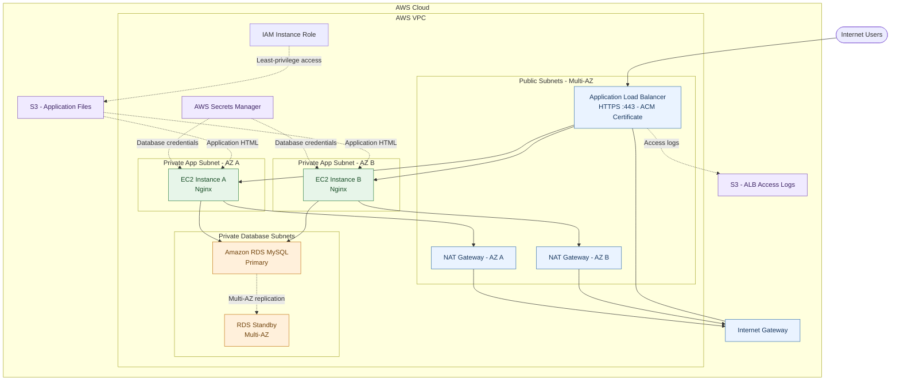

# AWS DevOps Assignment — Architecture Diagram

## Target Architecture

## CI/CD Workflow

```mermaid
flowchart LR
    A[Developer Pushes Code] --> B[GitHub Repository]
    B --> C[GitHub Actions]
    C --> D[Terraform Format]
    D --> E[Terraform Init]
    E --> F[Terraform Validate]
    F --> G[Terraform Plan]
    G --> H[Manual Approval]
    H --> I[Terraform Apply]
    I --> J[Deployment Health Checks]
```

## Notes

- This is the target architecture for the assignment.
- HTTPS requires a valid ACM certificate and an HTTPS listener on the ALB.
- The database is intended to remain in private subnets.
- The CI/CD diagram describes the intended pipeline; the current GitHub Actions workflow only performs Terraform formatting, initialization, and validation.
- Confirm all resources are deployed and configured before presenting the target architecture as the completed implementation.
